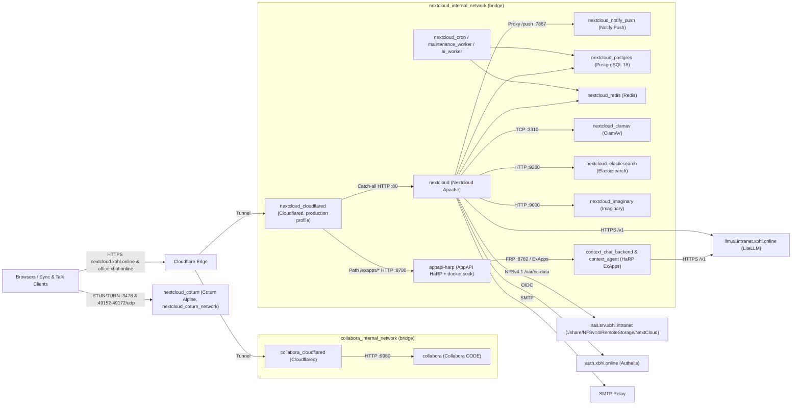

# Nextcloud & Collabora Office Suite

> Version: `35.0.2-apache` (Collabora `26.04.5.2.1`) | Images: `nextcloud:35.0.2-apache`, `collabora/code:26.04.5.2.1`, `postgres:18.6`, `redis:8.10.3`, `clamav/clamav:1.5.4_base`, `docker.elastic.co/elasticsearch/elasticsearch:9.5.5`, `nextcloud/aio-imaginary:20261021_180331`, `coturn/coturn:4.18.0-alpine`, `ghcr.io/nextcloud/notify_push:v1.4.2`, `ghcr.io/nextcloud/nextcloud-appapi-harp:v0.4.7`, `cloudflare/cloudflared:2026.10.5` | Upstream: https://github.com/nextcloud/server

Self-hosted private cloud storage, real-time collaborative office suite (Collabora Online), WebRTC audio/video communication (Talk + Coturn), full-text search, antivirus scanning, and AppAPI/LiteLLM-backed AI assistant stack deployed as two independent Docker Compose stacks.

## Service Overview

| Property | Value |
| :--- | :--- |
| **Domain** | `https://nextcloud.xbhl.online` (Nextcloud Hub), `https://office.xbhl.online` (Collabora Online), `talk.nextcloud.xbhl.online` (Coturn STUN/TURN) |
| **Primary Node** | `cloud.vm.xbhl.intranet` (Docker Host VM) |
| **Deploy Path** | `/opt/containers/nextcloud` and `/opt/containers/collabora` |
| **Ingress Strategy** | Dual Cloudflare Tunnels (`cloudflare-dns-strategy: tunnel` via `$NEXTCLOUD_CLOUDFLARE_TUNNEL_UUID` & `$OFFICE_CLOUDFLARE_TUNNEL_UUID`) + direct host ports `3478/tcp`, `3478/udp`, `49152-49172/udp` (`nextcloud_coturn`) |
| **Topology Archetype** | Dual-Stack Application Suite (13-service Nextcloud stack + 2-service Collabora stack + HaRP Docker ExApps) |
| **Authentication** | Authelia OIDC (`user_oidc`, client `nextcloud` against `https://auth.xbhl.online`) with native login form hidden and built-in 2FA/LDAP disabled |
| **Ecosystem** | WUD tracking across all 11 container images (`wud.watch=true`); Gatus HTTP & container monitors (`nextcloud` group on `https://status.intranet.xbhl.online` for both `nextcloud` and `collabora`); Homepage service widget & bookmark (`https://start.intranet.xbhl.online`); Authelia OIDC client `nextcloud` |

## Architecture & Communication



- **Dual Child-Pipeline Deployment**: `.gitlab-ci.yml` triggers two independent child pipelines (`strategy: depend`) on `cloud.vm.xbhl.intranet`: `src/collabora/collabora-ci-pipeline.yml` (`/opt/containers/collabora`) and `src/nextcloud/nextcloud-ci-pipeline.yml` (`/opt/containers/nextcloud`).
- **Cloudflare Ingress & Dynamic Coturn DNS**: `nextcloud_cloudflared` (`profiles: ["production"]`, skipped in DinD tests) routes `^/exapps/` to `http://appapi-harp:8780` and all remaining `nextcloud.xbhl.online` traffic to `http://nextcloud:80` (where Apache reverse-proxies `/push` and `/push/ws` to `notify_push:7867`). `collabora_cloudflared` routes `office.xbhl.online` to `http://collabora:9980`. Before starting Nextcloud on `main`, CI job `deploy:nextcloud:update-coturn-dns` resolves the router's public IPv4 (`api.ipify.org` / `ifconfig.me` / `icanhazip.com`) and updates the unproxied (`TTL: 120`) Cloudflare `A` record `talk.nextcloud.xbhl.online`, which `nextcloud_coturn` resolves via `dig` at startup to set `--external-ip`.
- **Custom Images & Post-Deploy Reconciliation**: `src/nextcloud/Dockerfile` extends the official Apache Nextcloud image with `ffmpeg`, `ghostscript`, `libmagickcore-*-extra`, `imagemagick`, `libimage-exiftool-perl`, `procps`, `curl`, `jq`, `config/custom.ini`, Apache HSTS/`notify_push` configs, and `/entrypoint-wrapper.sh`. `src/collabora/Dockerfile` copies static `/bin/wget` from `busybox` into `collabora/code` for its `/hosting/discovery` healthcheck. On container startup (and again in post-deploy CI stage `verify:nextcloud:config-reconciliation`), `/scripts/configure-nextcloud.sh` idempotently reconciles apps, caching, previews, OIDC, WOPI, antivirus, search, Talk, SMTP, push, and AI settings.

### Storage, OIDC & AI Integrations

- **Storage Layout**: User files reside on NFSv4.1 volume `nextcloud_data` mounted at `/var/nc-data:nocopy` (`nas.srv.xbhl.intranet:/share/NFSv=4/RemoteStorage/NextCloud`, overridden with a `/tmp/nextcloud-test-data` local bind mount in `test:nextcloud:docker-compose`). Application code and config (`nextcloud_html:/var/www/html`), PostgreSQL (`postgres_data:/var/lib/postgresql`), Redis (`redis_data:/data`, `512mb` `volatile-lru` + transactional file locking), ClamAV signatures (`clamav_db:/var/lib/clamav`), Elasticsearch indices (`elasticsearch_data`), and HaRP certs (`appapi_harp_certs:/certs`) remain on host-local named volumes.
- **Authelia SSO (`user_oidc`)**: Configured against `https://auth.xbhl.online/.well-known/openid-configuration` (`client_id: nextcloud`, `client_secret_post`, `enrich_login_id_token_with_userinfo=true`). Native login and password reset are hidden (`hide_login_form=true`, `lost_password_link=disabled`), Nextcloud built-in 2FA/LDAP/registration/encryption apps are disabled, and `${NEXTCLOUD_MAIN_USER}` (`lukasz.barczynski`) is automatically added to the `admin` group once provisioned on first OIDC login.
- **Collabora, Media, Search & Antivirus**:
  - **Collabora Online (`richdocuments`)**: Configured with `wopi_url` / `public_wopi_url` `https://office.xbhl.online` (`ooxml` default) and restricted via `aliasgroup1=https://nextcloud.xbhl.online:443`.
  - **Imaginary, Memories & Recognize**: Offloads image/PDF thumbnail rendering to `http://imaginary:9000` (`libvips`), pairs `ffmpeg`/`ffprobe`/`exiftool` with Nextcloud Memories, and enables local ML classification/face clustering in Recognize.
  - **Full-Text Search & ClamAV**: Indexes local, PDF, Office, and metadata content in single-node Elasticsearch (`http://elasticsearch:9200`, index `nextcloud`) and scans uploads via `clamav:3310` (`av_mode=daemon`, `av_infected_action=delete`, `av_stream_max_length=100000000`).
- **LiteLLM Assistant, Context Chat & Context Agent**:
  - **Nextcloud Assistant (`integration_openai`)**: Connects to external OpenAI-compatible proxy `https://llm.ai.intranet.xbhl.online/v1` (`LiteLLM@XBHL.online`) using model aliases `xbhl/chat`, `xbhl/embed`, `xbhl/transcribe`, `xbhl/tts`, and `xbhl/image` (`envs/ai.env`).
  - **Context Chat & Context Agent (AppAPI + HaRP)**: `appapi-harp` mounts `/var/run/docker.sock` and registers deploy daemon `harp_docker` (`appapi-harp:8780`, FRP `appapi-harp:8782`) on `nextcloud_internal_network` to run ExApp containers `context_chat_backend` (RAG over user files using the external `xbhl/embed` endpoint — no local GPU required) and `context_agent` (tool-calling Assistant actions across files, search, calendar, tasks, Talk, and mail with interactive confirmation for mutating operations).

### Background Workers, Cron & On-Demand Maintenance (OCC CLI)

Four containers run from the same custom Nextcloud Apache image (`src/nextcloud/docker-compose.yml`):

1. **`nextcloud`**: Serves HTTP traffic via `apache2-foreground`, heals pending upgrades (`needsDbUpgrade -> occ upgrade`) on startup, and launches background config reconciliation via `run-init.sh`.
2. **`nextcloud_cron`**: Executes `/cron.sh` (`php /var/www/html/cron.php`) for standard Nextcloud background jobs.
3. **`nextcloud_ai_worker`**: Runs `/scripts/continuous-worker.sh 3600` (`occ taskprocessing:worker -v -t 3600` in a continuous loop) for low-latency AI Assistant task execution.
4. **`nextcloud_maintenance_worker`**: Runs `/scripts/maintenance-worker.sh` on a `300s` loop:
   - **Every 5 minutes (`frequent.sh`)**: `occ preview:pre-generate` and `occ memories:index`.
   - **Every 12 cycles / ~1 hour (`hourly.sh`)**: `occ fulltextsearch:index`, `occ recognize:classify`, `occ recognize:cluster-faces`, and bruteforce allowlist refresh.
   - **Daily (`01:00–05:00 UTC`, `daily.sh`)**: `occ app:update --all` (with `occ upgrade` fallback on PHP class skew), `occ recognize:download-models`, `occ files:cleanup`, `occ db:add-missing-indices` / `db:add-missing-primary-keys` / `db:add-missing-columns`, and `occ maintenance:repair`.

#### Running `occ` Commands & On-Demand Full Rescan

Run ad-hoc Nextcloud CLI (`occ`) commands as `www-data` inside `nextcloud`:

```bash
docker exec -u www-data nextcloud php /var/www/html/occ status
```

To manually run a complete maintenance and full-library rescan cycle (`cron.php` + frequent/hourly/daily tasks + `recognize:recrawl` + `duplicates:find-all` + `maintenance:repair --include-expensive`):

```bash
docker exec -it nextcloud /scripts/maintenance-worker.sh --now
```

`configure-nextcloud.sh`, `maintenance-worker.sh`, and `continuous-worker.sh` coordinate via an exclusive `flock` descriptor (`src/nextcloud/scripts/common/lock.sh`) on `/var/www/html/config/.nextcloud-maintenance.lock` inside the shared `nextcloud_html:/var/www/html` volume. By default, `--now` uses non-blocking `flock -n` and exits immediately if another configuration or maintenance run holds the lock. Pass `--force` to wait up to `300s` (`flock -w 300`) for the active holder to finish instead of skipping:

```bash
docker exec -it nextcloud /scripts/maintenance-worker.sh --now --force
```

`--force` waits on the `flock` lock rather than signaling another container's process namespace; if a run is genuinely wedged, inspect and terminate the stuck process inside `nextcloud_maintenance_worker` (or `nextcloud`) directly.

### Directory Structure

```text
├── .gitlab-ci.yml                  # Parent pipeline triggering Collabora & Nextcloud child pipelines
├── scripts/                        # CI helpers (Cloudflare tunnel credentials, .env key injection)
└── src/
    ├── collabora/                  # Collabora Online compose, Dockerfile, cloudflared config, envs & CI pipeline
    └── nextcloud/                  # Nextcloud compose, Dockerfile, custom.ini, cloudflared config, envs, scripts & CI pipeline
```

## Required GitLab CI/CD Variables

| Scope | Variable(s) | Requirement & Injection Target |
| :--- | :--- | :--- |
| **Project** | `NEXTCLOUD_CLOUDFLARE_TUNNEL_UUID`, `NEXTCLOUD_CLOUDFLARE_TUNNEL_TOKEN` | **Required** (`:?`); populates `.nextcloud_generated_sources/cloudflared-config/{config.yml,credentials.json}` and Cloudflare CNAME `nextcloud.xbhl.online`. |
| **Project** | `OFFICE_CLOUDFLARE_TUNNEL_UUID`, `OFFICE_CLOUDFLARE_TUNNEL_TOKEN` | **Required** (`:?`); populates `.collabora_generated_sources/cloudflared-config/{config.yml,credentials.json}` and Cloudflare CNAME `office.xbhl.online`. |
| **Project** | `NEXTCLOUD_ADMIN_PASSWORD`, `NEXTCLOUD_DB_PASSWORD`, `NEXTCLOUD_REDIS_PASSWORD` | **Required** (`:?`); injected into `envs/nextcloud.env`, `envs/db.env`, and `envs/redis.env`. |
| **Project** | `NEXTCLOUD_OAUTH_CLIENT_SECRET`, `NEXTCLOUD_COTURN_SECRET`, `NEXTCLOUD_APPAPI_HARP_SHARED_KEY` | **Required** (`:?`); injected into `envs/oidc.env` (`OIDC_CLIENT_SECRET`), `envs/talk.env` (`COTURN_SECRET`), and `envs/appapi.env` (`HP_SHARED_KEY`). |
| **Project** | `AI_API_KEY` | **Required** (`:?`); injected into `.nextcloud_generated_sources/envs/ai.env` for LiteLLM Assistant & `context_chat_backend` embeddings. |
| **Project** | `GIPHY_API_KEY` | **Optional** (`${GIPHY_API_KEY:-}`); injected into `envs/api-keys.env` (activates `integration_giphy` in Talk only when non-empty). |
| **Group-Inherited (`home-lab`)** | `SSH_USER`, `SSH_PRIVATE_KEY`, `CLOUDFLARE_ZONE_ID`, `CLOUDFLARE_DNS_API_TOKEN` | **Required**; SSH deployment to `cloud.vm.xbhl.intranet`, tunnel CNAME provisioning, and `deploy:nextcloud:update-coturn-dns` (`talk.nextcloud.xbhl.online`). |
| **Group-Inherited (`home-lab`)** | `SMTP_HOST`, `SMTP_PORT`, `SMTP_USERNAME`, `SMTP_PASSWORD`, `SMTP_FROM` | **Required** (`:?`); injected into `.nextcloud_generated_sources/envs/smtp.env`. |

## Upgrades & Maintenance

- **Upstream & Wrapper Sources**: Nextcloud Server migration notes (`https://docs.nextcloud.com/server/latest/admin_manual/release_notes/index.html`) and Docker wrapper (`https://github.com/nextcloud/docker`); `aio-imaginary` build source (`https://github.com/nextcloud/all-in-one/tree/main/Containers/imaginary`); `clamav` Docker wrapper (`https://github.com/Cisco-Talos/clamav-docker`); HaRP ExApps `context_chat_backend` (`https://github.com/nextcloud/context_chat_backend`) and `context_agent` (`https://github.com/nextcloud/context_agent`); remaining images tracked via `wud.link.template`.
- **Version & Flavor Constraints**: Never skip Nextcloud major versions; keep `nextcloud` pinned to `-apache`, `postgres_db` to PostgreSQL 18 (`^18\.\d+$`, `/var/lib/postgresql` mount), `clamav` to `_base` (runtime `freshclam` DB; keep `av_stream_max_length <= StreamMaxLength`), `coturn` to `-alpine`, and `context_chat_backend` `--info-xml` tag in `src/nextcloud/scripts/configure/ai.sh` matched to `context_chat` `major.minor`.
- **Intentional Choices (Do Not Propose)**: Authelia OIDC-only auth with Nextcloud 2FA/LDAP/encryption/registration apps disabled in `src/nextcloud/scripts/configure/apps.sh` (`app_install_overwrite` kept for `files_fulltextsearch_metadata`); `opcache.revalidate_freq=60` (never `opcache.validate_timestamps=0`) in `src/nextcloud/config/custom.ini` for daily `occ app:update --all`; external LiteLLM endpoint (`envs/ai.env`) without local GPU/models; direct `/var/run/docker.sock` mount on `appapi-harp` for sibling ExApp containers (`^/exapps/` routed to `appapi-harp:8780`); single-node Elasticsearch with `xpack.security.enabled=false` on isolated internal network; `coturn` `entrypoint: []` bypass with `--no-tcp-relay` and direct host ports; non-recursive top-level `chown` on NFS `/var/nc-data`.
- **Upgrade & CI Gotchas**: Sync custom-build tags across `src/nextcloud/Dockerfile` + all 4 `image: nextcloud:*` services in `src/nextcloud/docker-compose.yml`, across `src/collabora/Dockerfile` + `src/collabora/docker-compose.yml` (`busybox:*-musl` helper stage and CI `alpine` image are untracked by WUD), and `cloudflared` across both compose files (`profiles: ["production"]` in Nextcloud only); `ai.sh` skips `context_chat_backend` registration once present in `occ app_api:app:list` (bumping `--info-xml` requires `occ app_api:app:*` reconciliation); preserve `$BUILD_ARTIFACTS_DIR/` in both `setup:generate-build-artifacts` overrides, `NEXTCLOUD_STORAGE_*` DinD bind overrides, `shellcheck -x -S warning` on `*.sh`, `deploy:nextcloud:update-coturn-dns`, and `verify:nextcloud:config-reconciliation`.
