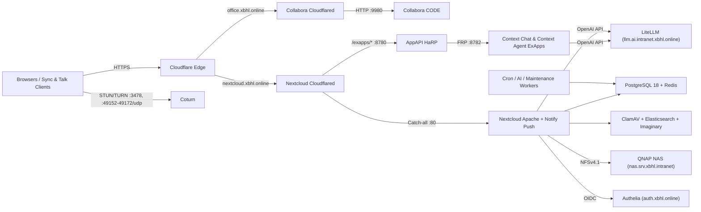

# Nextcloud & Collabora Office Suite

> Version: `35.0.2-apache` (Collabora `26.04.5.2.1`) | Images: `nextcloud:35.0.2-apache`, `collabora/code:26.04.5.2.1`, `busybox:1.37.0-musl`, `postgres:18.6`, `redis:8.10.3`, `clamav/clamav:1.5.4_base`, `docker.elastic.co/elasticsearch/elasticsearch:9.5.5`, `nextcloud/aio-imaginary:20261021_180331`, `coturn/coturn:4.18.0-alpine`, `ghcr.io/nextcloud/notify_push:v1.4.2`, `ghcr.io/nextcloud/nextcloud-appapi-harp:v0.4.7`, `cloudflare/cloudflared:2026.10.5` | Upstream: https://github.com/nextcloud/server

Self-hosted private cloud storage, real-time collaborative office suite (Collabora Online), WebRTC audio/video communication (Talk + Coturn), full-text search, antivirus scanning, and AppAPI/LiteLLM-backed AI assistant deployed as two independent stacks.

## Overview

| Property | Value |
| :--- | :--- |
| **Domain** | `https://nextcloud.xbhl.online`, `https://office.xbhl.online`, `talk.nextcloud.xbhl.online` |
| **Node** | `cloud.vm.xbhl.intranet` |
| **Ingress** | Dual Cloudflare Tunnels (Nextcloud & Collabora) + direct host ports `3478/tcp+udp` and `49152-49172/udp` (Coturn) |
| **Authentication** | Authelia OIDC SSO (`user_oidc`; native login hidden and built-in 2FA/LDAP/registration disabled) |
| **Ecosystem** | WUD image tracking; Gatus HTTP & container monitors; Homepage widget & bookmark; Authelia OIDC client; LiteLLM proxy |

## Architecture & Key Decisions



- **Independent Child Pipelines**: `.gitlab-ci.yml` triggers isolated `collabora` and `nextcloud` child pipelines (`strategy: depend`) so Collabora CODE deploys never disrupt Nextcloud sync, storage, or background workers.
- **Dual Cloudflare Tunnels & Dynamic Coturn DNS**: Dedicated `cloudflared` daemons publish `office.xbhl.online` (`:9980`) and `nextcloud.xbhl.online` (`^/exapps/` to `appapi-harp:8780`; catch-all to Apache `:80`, which proxies `/push` to `notify_push`). Because Cloudflare Tunnels cannot carry WebRTC media, CI job `deploy:nextcloud:update-coturn-dns` updates unproxied `A` record `talk.nextcloud.xbhl.online` with the router's public IPv4 before startup so Coturn discovers `--external-ip` via DNS.
- **Authelia OIDC SSO & QNAP NFSv4 Storage**: Startup and post-deploy `configure-nextcloud.sh` runs idempotently reconcile Authelia OIDC (`user_oidc`, auto-promoting the primary user to `admin`), Collabora WOPI, Imaginary, Memories, Recognize, Elasticsearch, and ClamAV upload scanning, while storing user files on QNAP NFSv4.1 (`nas.srv.xbhl.intranet`) and keeping transactional databases/indices on local host storage.
- **LiteLLM Assistant & AppAPI HaRP ExApps**: Nextcloud Assistant (`integration_openai`) delegates chat, embeddings, STT, TTS, and image generation to `llm.ai.intranet.xbhl.online`, while `appapi-harp` runs sibling Docker ExApps `context_chat_backend` (RAG using remote LiteLLM embeddings without a local GPU) and `context_agent` (tool-calling Assistant actions).
- **Dedicated Cron, AI & Maintenance Worker Split**: Four containers share the custom Nextcloud image (`ffmpeg`, `ghostscript`, `imagemagick`, `exiftool`): `nextcloud` serves HTTP and `run-init.sh` reconciliation, `nextcloud_cron` runs `cron.php`, `nextcloud_ai_worker` runs continuous `occ taskprocessing:worker` loops for low-latency Assistant tasks, and `nextcloud_maintenance_worker` runs tiered 5-minute, hourly, and daily media/index/repair jobs.

### Operator CLI (`occ` & On-Demand Maintenance)

Run ad-hoc `occ` commands as `www-data` or trigger a full on-demand maintenance and library rescan cycle (`cron.php`, previews, search/Memories/Recognize indexing, duplicate detection, and `maintenance:repair --include-expensive`):

```bash
docker exec -u www-data nextcloud php /var/www/html/occ status
docker exec -it nextcloud /scripts/maintenance-worker.sh --now [--force]
```

`configure-nextcloud.sh`, `maintenance-worker.sh`, and `continuous-worker.sh` coordinate via an exclusive `flock` lock (`scripts/common/lock.sh`) shared across the Nextcloud containers. `--now` uses non-blocking `flock -n` and exits immediately if busy; `--force` waits up to `300s` (`flock -w 300`) for the active holder to finish rather than signaling processes across containers.

### External Credentials

- **Cloudflare Tunnels**: `NEXTCLOUD_CLOUDFLARE_TUNNEL_UUID` / `NEXTCLOUD_CLOUDFLARE_TUNNEL_TOKEN` and `OFFICE_CLOUDFLARE_TUNNEL_UUID` / `OFFICE_CLOUDFLARE_TUNNEL_TOKEN` (Cloudflare Zero Trust tunnels for `nextcloud.xbhl.online` and `office.xbhl.online`).
- **LiteLLM Proxy Key**: `AI_API_KEY` (virtual key issued on `llm.ai.intranet.xbhl.online` for Nextcloud Assistant and `context_chat_backend` embeddings).

## Upgrades & Maintenance

- **Upstream & Wrapper Sources**: Check [Nextcloud Server release notes](https://docs.nextcloud.com/server/latest/admin_manual/release_notes/index.html), [`nextcloud/docker`](https://github.com/nextcloud/docker), [`aio-imaginary`](https://github.com/nextcloud/all-in-one/tree/main/Containers/imaginary), [`clamav-docker`](https://github.com/Cisco-Talos/clamav-docker), and HaRP ExApps [`context_chat_backend`](https://github.com/nextcloud/context_chat_backend) / [`context_agent`](https://github.com/nextcloud/context_agent).
- **Version & Flavor Constraints**: Never skip Nextcloud major versions; keep `nextcloud` on `-apache`, `postgres_db` on PostgreSQL 18, `clamav` on `_base` (runtime `freshclam`), `coturn` on `-alpine`, and `context_chat_backend` `--info-xml` in `scripts/configure/ai.sh` aligned with `context_chat` `major.minor`.
- **Intentional Choices (Do Not Propose)**: Authelia OIDC-only auth with built-in 2FA/LDAP/encryption disabled; `opcache.revalidate_freq=60` in `config/custom.ini` so daily `occ app:update --all` reloads cleanly; external LiteLLM proxy without local GPU models; Docker socket access on `appapi-harp` for sibling ExApps; single-node Elasticsearch without `xpack.security` on the isolated bridge; `coturn` `entrypoint: []` bypass with `--no-tcp-relay`; non-recursive top-level `chown` on NFS storage.
- **Upgrade & CI Gotchas**: Bump `nextcloud` across `src/nextcloud/Dockerfile` and all 4 worker services in `src/nextcloud/docker-compose.yml`, `collabora/code` across `src/collabora/Dockerfile` and `src/collabora/docker-compose.yml` (`busybox:*-musl` helper stage and CI `alpine` image are untracked by WUD), and `cloudflared` across both stacks (`profiles: ["production"]` in Nextcloud only); bumping `context_chat_backend` requires `occ app_api:app:*` reconciliation since `ai.sh` skips already-registered ExApps.
